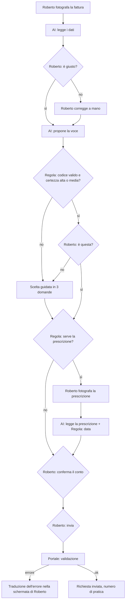

# Workflow del percorso assistito

Ogni passo ha un solo responsabile. Il colore della pastiglia nell'app (attivabile con "Mostra chi fa cosa") corrisponde a questa tabella.

| Passo | Cosa succede | Chi lo fa |
|---|---|---|
| 1 | Roberto fotografa la fattura | Roberto |
| 2 | Lettura dei dati dalla foto | **AI** · Agente 1 Lettore fattura |
| 3 | Frase letta ad alta voce con importi e date | Regola fissa (funzione `fraseFattura`) |
| 4 | "È giusto?" | **Roberto decide** |
| 5 | Proposta della voce del modulo | **AI** · Agente 2 Classificatore |
| 6 | Il codice esiste nel catalogo? Certezza sufficiente? | Regola fissa |
| 7 | "È questa?" oppure scelta guidata in 3 domande | **Roberto decide** (scelta guidata: regola fissa) |
| 8 | La voce richiede la prescrizione? | Regola fissa (catalogo) |
| 9 | Lettura della prescrizione | **AI** · Agente 3 Verificatore |
| 10 | Data prescrizione ≤ data visita | Regola fissa |
| 11 | Conferma del conto per il rimborso | **Roberto decide** |
| 12 | Riepilogo e invio | **Roberto decide** |
| 13 | Validazione del portale | Portale (stessa funzione della scheda "Prima") |
| 14 | Se c'è un errore: traduzione | Regola fissa per errori noti, **AI** Agente 4 per gli altri |

## Cosa succede se l'AI non risponde

| Agente | Ripiego |
|---|---|
| Lettore fattura | Roberto inserisce i dati a mano, un campo per schermata |
| Classificatore | Scelta guidata in 3 domande |
| Verificatore prescrizione | Roberto conferma a voce di avere il foglio; la regola sulla data usa la data che inserisce |
| Traduttore errori | Messaggio generico: "Il portale ha dato un errore che non conosco" + testo originale + invito a chiedere aiuto |

In modalità dimostrativa (nessuna connessione all'AI), con i documenti di esempio l'app usa risposte preparate nello stesso formato JSON degli agenti (oggetto `RISPOSTE_DEMO` in `app/index.html`). La schermata lo dichiara con l'etichetta "Risposta preparata". Durante la prova con l'AI collegata, il team sostituisce queste risposte con gli output reali ottenuti sui documenti di esempio, così la demo offline riproduce fedelmente il comportamento vero.
